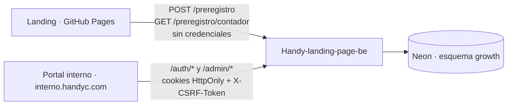
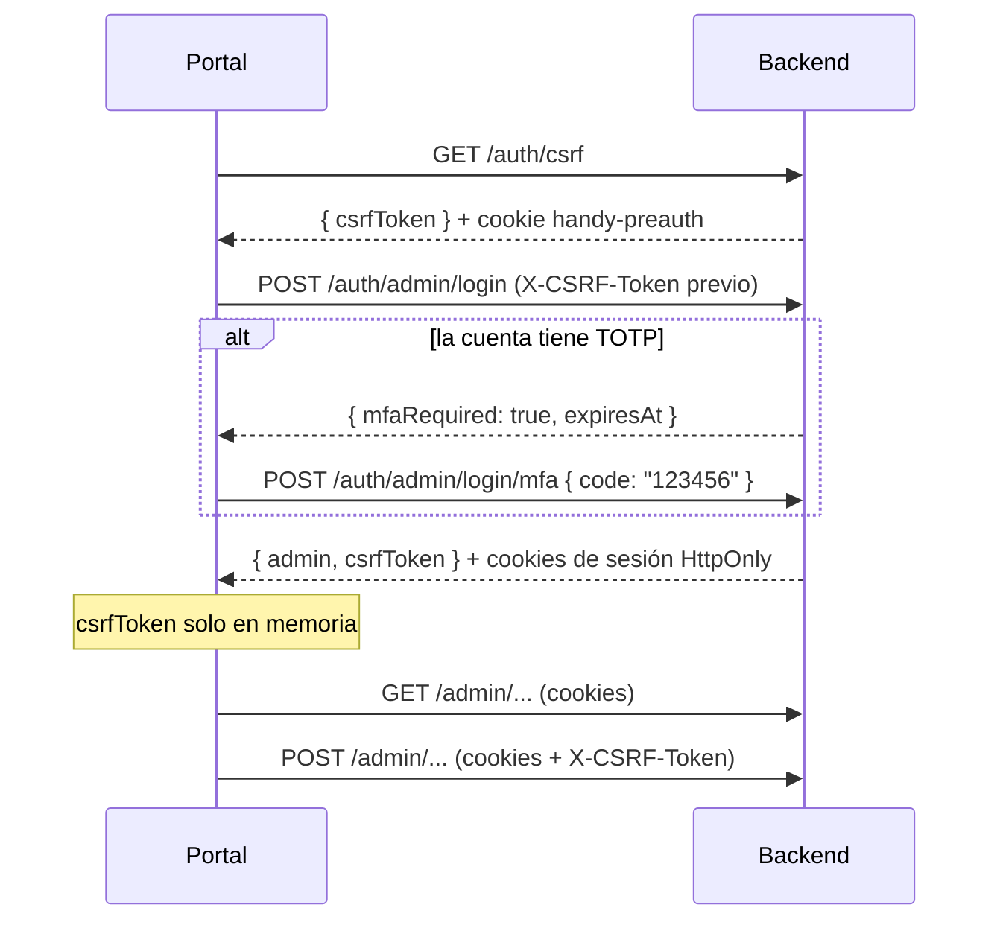

# Contrato de Handy-landing-page-be

**Estado: implementado en el backend (Fase 2), consumido por el portal (Fase 3); sin desplegar.** El contrato vigente es el del backend: `docs/openapi.json`, `docs/auth.md`, `docs/crm.md` y `docs/contract-delta.md` de `Handy-landing-page-be`. Este documento resume lo que el portal usa y **prevalece sobre la propuesta anterior** (ver [Diferencias con la propuesta](#diferencias-con-la-propuesta-anterior)). Si el backend cambia, se actualizan en el mismo cambio `src/contracts/landing-api.ts`, `src/data/http-source.ts` / `admin-session.ts` y este documento.

Las pruebas de este repositorio usan un backend simulado: **el contrato todavía no se probó de punta a punta contra el backend real.**

## Clientes y configuración



| Cliente | Variable | Dónde se define | Vacía significa |
|---|---|---|---|
| Landing | `VITE_FORM_ENDPOINT` | Variable `FORM_ENDPOINT` del repo de la landing o `.env.local` | Formulario en "Registro habilitado en breve" |
| Portal | `VITE_API_BASE_URL` | Build del portal o `.env.local`. **Pública** (queda en el bundle). **Nunca en el deploy de GitHub Pages** (TECH-31: el build lo rechaza) | Sin backend: solo existe la muestra `?demo=1` |
| Portal (solo build) | `BASE_PATH` | Build; no es una URL del backend | `/` (o `/handy-internal-portal/` con `GITHUB_PAGES=true`) |

Ambas URLs van sin barra final. El portal **no tiene** más configuración: ni secretos, ni credenciales, ni claves.

### Origen y desarrollo local

El backend exige la cabecera `Origin` **exacta** (`ADMIN_ALLOWED_ORIGINS`) en toda ruta `/auth` y `/admin`, también en los GET. Un navegador no manda `Origin` en un GET del mismo origen, así que **un proxy de desarrollo del mismo origen no sirve**: devolvería `403 origen_no_permitido`. Por eso el portal llama al backend siempre de origen cruzado:

- Desarrollo: portal en `http://127.0.0.1:5174` (puerto fijo en `vite.config.ts`), backend en `http://127.0.0.1:3000` con `AUTH_ENABLED=true` y `ADMIN_ALLOWED_ORIGINS=http://127.0.0.1:5174`. Mismo host (`127.0.0.1`) para que la cookie `SameSite=Lax` viaje.
- Producción prevista: portal `https://interno.handyc.com`, API `https://api.handyc.com` (mismo sitio, orígenes distintos). Las cookies son host-only de la API (`__Host-` en producción).

## Autenticación del equipo

Email + contraseña validados únicamente contra `ADMIN_ACCOUNTS_JSON` del entorno privado del backend. No hay registro, recuperación ni credenciales en el portal. Detalle completo en `docs/auth.md` del backend.



| Ruta | Uso en el portal |
|---|---|
| `GET /auth/csrf` | CSRF previo al login (10 min). Se pide justo antes de cada intento de ingreso |
| `POST /auth/admin/login` | `{ email, password }` (contraseña de 12 a 128 caracteres). Responde sesión o `{ mfaRequired: true, expiresAt }` |
| `POST /auth/admin/login/mfa` | `{ code }` de 6 dígitos. Reusa el CSRF previo |
| `GET /auth/admin/me` y `GET /auth/admin/csrf` | Al **recargar** la página: perfil y `csrfToken` de la sesión viva. `csrf` funciona también con solo el refresh vigente |
| `POST /auth/admin/refresh` | Cuerpo `{}` + `X-CSRF-Token`. Rota las cookies. Reusar un refresh viejo revoca la familia |
| `POST /auth/admin/logout` | Cuerpo `{}` + `X-CSRF-Token`. `204` |

Reglas del cliente (`src/data/admin-session.ts`):

- `credentials: "include"` en todos los pedidos; el navegador maneja las cookies, el portal nunca las lee.
- `X-CSRF-Token` en todo `POST`. **El `csrfToken` vive solo en un campo privado en memoria**: ni `localStorage`, ni `sessionStorage`, ni cookies propias, ni URL, ni DOM. Una prueba estática (`src/security/no-storage.test.ts`) lo vigila.
- **Un 401 en un pedido autenticado** dispara **un solo refresh en vuelo** (los pedidos concurrentes esperan la misma promesa) y **un único reintento** con las mismas cabeceras (incluida `Idempotency-Key`). Si el refresh devuelve 401 o el reintento sigue en 401, la sesión se da por vencida y se muestra el login. Un corte de red o un 503 durante el refresh **no** tiran la sesión.
- Al reintentar tras un refresh, el `X-CSRF-Token` es el que devolvió el refresh.
- `logout` limpia la memoria aunque el servidor falle.
- Las sesiones del backend viven **en memoria de una instancia**: un redeploy o reinicio exige volver a ingresar (el portal lo muestra como "Tu sesión venció").
- Vencimiento absoluto de 8 h (`ADMIN_SESSION_TTL_SECONDS`): el refresh no lo extiende.

### Permisos

El portal los lee de `permissions` (login, refresh o `/auth/admin/me`). Un permiso desconocido se descarta. **El servidor los exige en cada endpoint**; la UI solo evita ofrecer lo que va a rechazar.

| Permiso | El portal | Efecto si falta |
|---|---|---|
| `auth:read` | `GET /auth/admin/me` al recargar | `/me` responde 403 `sin_permiso`: la sesión queda en "acceso denegado" (solo permite cerrar sesión) |
| `preregistros:read` | Mínimo para operar: resumen, listas y fichas | Pantalla "Tu cuenta no tiene acceso" |
| `preregistros:contact` (+ `read`) | Registrar contactos y abrir WhatsApp | Formulario y botón de WhatsApp deshabilitados, con la explicación |
| `preregistros:support` (+ `read`) | Buscar a un **usuario** por su email exacto | La búsqueda de usuarios acepta solo ID; un email no se envía y se explica |

## Errores

Cuerpo `{ "error": "<código>" }`; `400` suma `campos` (nombres, nunca valores) y `409` suma `motivo`. El portal traduce cada uno a un mensaje propio y **nunca muestra el cuerpo del servidor**.

| Estado | `error` / `motivo` | Qué hace el portal |
|---|---|---|
| `400` | `validacion` + `campos` | Marca los campos rechazados (`motivo`, `proximoSeguimiento`, `fechaAltaAceptada`, `q`…) |
| `401` | `no_autenticado` | Refresh serializado + un reintento; si no alcanza, pantalla de login |
| `403` | `sin_permiso` | Mensaje de permiso faltante (con el permiso esperado cuando se conoce) |
| `403` | `csrf_invalido` | "La protección de la sesión no coincide" + botón **Recargar la sesión** (vuelve a pedir `GET /auth/admin/csrf`) |
| `403` | `origen_no_permitido` | "Este sitio no está autorizado por el servidor": se avisa a quien administra el entorno (`ADMIN_ALLOWED_ORIGINS`) |
| `404` | `no_encontrado` | Ficha inexistente o vencida (un id mal formado también es 404) |
| `409` | `conflicto` + `motivo: "version"` | Alguien más cambió la ficha: se **recarga**, se avisa y se conserva lo escrito en el formulario (solo en memoria) |
| `409` | `motivo: "transicion"` | La etapa cambió y la acción ya no corresponde: se recarga la ficha |
| `409` | `motivo: "idempotencia"` | La clave ya se usó con otro cuerpo: se avisa y el próximo envío estrena clave |
| `413` | `payload_grande` | Error de pedido genérico |
| `429` | `limite` | "Demasiados pedidos seguidos" + Reintentar |
| `503` | `no_disponible` | "El servidor no está disponible" + Reintentar. En los eventos, nada se cambió |
| red / `5xx` | — | Estado de error recuperable con Reintentar. Las lecturas no cambian datos |

Si falla la auditoría de una lectura, el backend responde `503` y **no entrega datos**: el portal lo muestra como indisponibilidad, nunca como lista vacía. `Retry-After` no está expuesto por CORS (`exposedHeaders` solo trae `X-Request-Id`), así que el portal no lo usa.

## Endpoints administrativos

Todos exigen sesión viva y `preregistros:read`. Respuestas privadas (`Cache-Control: no-store`). Los pedidos van con `cache: "no-store"`.

### `GET /admin/preregistros/resumen`

```json
{
  "especialistas": 14, "usuarios": 11,
  "porEstado": { "todos": 14, "sin_contactar": 6, "con_intentos": 3, "contactado": 2, "comprometido": 3 },
  "porRubro": { "electricidad": 4, "plomeria": 4, "gas": 3 },
  "cola": [ /* hasta 5 FilaEspecialista, ya ordenada por el servidor */ ]
}
```

`porRubro` puede omitir rubros en 0 (el portal completa con 0). `porEstado` es **derivado**, no son etapas. Cada lectura queda auditada: el portal pide el resumen una vez por pantalla dibujada.

### `GET /admin/preregistros`

Parámetros: `tipo` (`especialista` | `usuario`, obligatorio), `q`, `rubro`, `zona`, `contacto`, `orden` (`recientes` · `antiguos` · `seguimiento`), `page` (desde 1) y `pageSize` (1 a 50; por defecto 8). **Un parámetro desconocido o repetido es `400`**, por eso en usuarios no se mandan `rubro`, `zona` ni `contacto`.

**`q` es una búsqueda EXACTA, nunca parcial ni por nombre** (la UI lo dice junto al campo). Según el código del backend (`src/services/crm.service.ts`):

| `tipo` | `q` acepta | Notas |
|---|---|---|
| `especialista` | ID (UUID) o WhatsApp completo (al menos 8 dígitos; el servidor lo normaliza) | **No** busca por email aunque `docs/crm.md` del backend lo mencione |
| `usuario` | ID (UUID) o email completo | El email exige `preregistros:support`; sin él, `403 sin_permiso` |

`zona` también es exacta (sin tildes, mayúsculas ni espacios de más). Respuesta: `{ rows, total, page, pageSize, totalPages }`; en especialistas suma `porEstado` (con los mismos filtros salvo `contacto`, para las pestañas).

`FilaEspecialista`:

```json
{ "id": "…uuid…", "tipo": "especialista", "nombre": "…", "whatsapp": "+5492230000001", "whatsappNormalizado": true,
  "email": null, "rubros": ["gas"], "zona": "Centro",
  "creadoEn": "2026-10-01T13:00:00.000Z", "venceEn": "2027-10-01T13:00:00.000Z",
  "etapa": "identificado", "contacto": "con_intentos", "intentos": 1,
  "proximoSeguimiento": "2026-10-12T13:00:00.000Z", "fechaAltaAceptada": null, "version": 2 }
```

- `email` es `string | null` (opcional en el formulario). Ya no existe `cuit`.
- `contacto` (`sin_contactar` · `con_intentos` · `contactado` · `comprometido`) **es derivado**, no una etapa: "con intentos" sigue siendo `identificado`.
- `whatsapp` viene en E.164 (`+549…`) cuando `whatsappNormalizado` es `true`; si es `false` es lo que escribió la persona y hay que **revisar el número**.
- `proximoSeguimiento` y `fechaAltaAceptada` son campos **distintos**.
- `version` es la que hay que devolver al registrar un evento.

`FilaUsuario`: `{ id, tipo: "usuario", creadoEn, venceEn }`. **Nada más**: ni nombre, barrio, necesidad, email ni WhatsApp.

### `GET /admin/preregistros/:id`

`FichaEspecialista` (la fila + `eventos`) o `FilaUsuario`. Un id inexistente, vencido o mal formado es `404`. Cada evento: `{ id, fecha, tipo, actorId, actor, motivo, proximoSeguimiento, fechaAltaAceptada }`; `actor` es el email del operador o `null` si ya no figura en el equipo.

### `POST /admin/preregistros/:id/eventos`

Exige `preregistros:contact` **y** `read`, `X-CSRF-Token` e `Idempotency-Key` (UUIDv4).

```json
{ "tipo": "compromiso", "motivo": "Acordamos el alta", "version": 3,
  "proximoSeguimiento": "2026-10-20T15:00:00.000Z", "fechaAltaAceptada": "2026-10-25T15:00:00.000Z" }
```

| Campo | Regla |
|---|---|
| `tipo` | `intento`, `conversacion` o `compromiso` |
| `motivo` | Nota neutra de 1 a 140 caracteres. El servidor rechaza teléfonos, emails, enlaces, documentos y cuentas (`400` con `campos: ["motivo"]`) |
| `version` | La de la ficha que vio el operador. Si cambió: `409 version` |
| `proximoSeguimiento` | Opcional. No menos de 5 min atrás y no después del vencimiento. Cada evento **reemplaza** el seguimiento anterior |
| `fechaAltaAceptada` | **Obligatoria en `compromiso`, prohibida en los otros tipos.** Desde ahora hasta 90 días y antes del vencimiento. Es un dato aparte: **no se reemplaza con `proximoSeguimiento`** y el portal no deja enviarlas iguales |

| Tipo | Etapa requerida | Efecto |
|---|---|---|
| `intento` | `identificado` | Suma un intento; la etapa no cambia |
| `conversacion` | `identificado` | Pasa a `contactado` |
| `compromiso` | `contactado` | Pasa a `comprometido` |

Cualquier otra combinación es `409 transicion`. Un `comprometido` no admite más eventos. El portal solo ofrece los tipos válidos para la etapa.

`201` la primera vez, `200` si se repite la misma clave con el mismo cuerpo (no se duplica), `409 idempotencia` si la clave se reusa con otro cuerpo. Responde la ficha actualizada.

**Idempotency-Key en el portal** (`src/domain/evento.ts`, `SubmissionKeys`): se genera un UUIDv4 por envío y se **reusa** mientras se reintente el **mismo** cuerpo sobre la **misma** ficha (red caída, 503, 429, timeout: no se sabe si el primer intento llegó). Cambiar el cuerpo o la ficha es otro envío y estrena clave; un éxito o un `409` la liberan. Vive solo en memoria. El reintento automático tras el refresh de sesión reusa la misma cabecera.

## WhatsApp

El backend **no** envía ni abre WhatsApp. En el portal es solo un **enlace que toca el operador**: `https://wa.me/<número normalizado>` con `target="_blank"` y `rel="noopener noreferrer"`, **sin texto prellenado** (el nombre y los rubros no viajan en la URL). Solo se arma si `whatsappNormalizado` es `true`; si no, la ficha avisa "Revisar el número" y el botón queda deshabilitado. El mensaje sugerido se copia y se pega a mano. Registrar qué pasó es una acción aparte del operador (un evento). Sin `preregistros:contact` no se ofrece ni el botón.

## Límites conocidos del backend

Documentados, no inventados:

- **No existe un evento de "seguimiento" para quien ya está `contactado`**: solo admite `compromiso`. El operador no puede registrar un nuevo intento ni mover `proximoSeguimiento` de un contactado hasta comprometerlo. `docs/crm.md` del backend lo menciona como limitación a validar con el equipo antes de la Fase 3 y `docs/auth.md` como "limitación conocida"; el portal no lo simula.
- `docs/crm.md` del backend dice que la búsqueda por email aplica a "id, WhatsApp, email" en general; el código la limita a usuarios con `preregistros:support` (ver tabla de `q`).
- Las sesiones se pierden al reiniciar el backend (una sola instancia).
- Riesgo residual de suplantación de contacto (alguien puede anotar un WhatsApp ajeno): el portal recuerda confirmar con la persona al contactarla.

## Endpoints públicos (landing)

Los usa la landing, no el portal. El contrato vigente (`POST /preregistro`, `GET /preregistro/contador`, CORS público sin credenciales) está en `docs/openapi.json` del backend. Cambios que la landing adopta en la Fase 3 (especialista sin `cuit` y con email opcional, usuario solo con email, `aviso`, esquema estricto) están en `docs/contract-delta.md` del backend; el portal ya modela los pre-registros con esa forma.

## Diferencias con la propuesta anterior

| Tema | Propuesta (2026-10-05) | Contrato implementado |
|---|---|---|
| Sesión | Cookie `HttpOnly`, `credentials: "include"` | Igual, más login en dos pasos, `X-CSRF-Token` en los POST, refresh rotativo serializado y CORS/Origin exactos |
| Especialista | `email` obligatorio, `cuit`, `etapa`, `eventos` en la lista, `especialistaId` | `email` nullable, **sin `cuit`**, `contacto`/`intentos`/`version`/`whatsappNormalizado`/`venceEn`/`fechaAltaAceptada`; `eventos` solo en la ficha; sin `especialistaId` |
| Usuario | `nombre`, `barrio`, `necesidad`, `dejoWhatsapp` | **Solo** `id`, `creadoEn`, `venceEn` |
| `q` | Parcial por nombre, zona, email o WhatsApp | **Exacta** (ID, WhatsApp; email de usuario con soporte) |
| Filtros | `cuit`, `contacto`, `rubro` | Sin `cuit`; suma `zona` y `orden=seguimiento`; usuarios no admiten filtros de especialista |
| Evento | `{ tipo, motivo, proximoSeguimiento? }` | Suma `version` y `fechaAltaAceptada` (compromiso), cabecera `Idempotency-Key`; `201`/`200` |
| Errores | `400/401/403/404/409` | Suma `csrf_invalido`, `origen_no_permitido`, `motivo` del `409`, `429`, `503` |
| Embudo | `porEstado` como "etapas" | `contacto`/`porEstado` son **derivados** |

## Sincronización

| Si cambia… | Actualizar en el mismo cambio |
|---|---|
| Los rubros del formulario | Landing, su copia en el backend y `RUBROS` de `src/contracts/landing-api.ts` |
| Una respuesta `/auth/*` o `/admin/*` | `src/contracts/landing-api.ts`, `src/data/admin-session.ts` / `http-source.ts`, sus pruebas y este documento |
