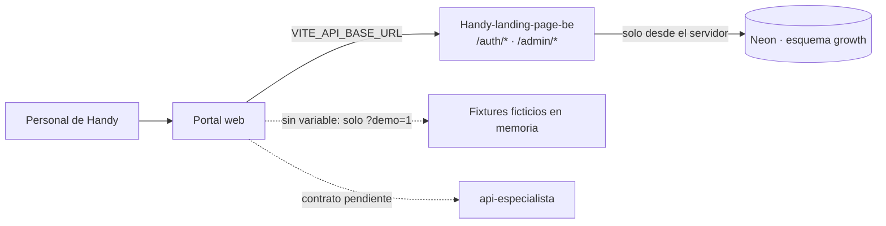

# Límites del sistema

## Estado observado

- `handy-internal-portal` es un repositorio separado. Las apps de usuario y especialista son React Native bare + TypeScript; este portal no las modifica ni las convierte a web.
- La landing de Handy está en otro repositorio y aporta tokens de marca y una referencia de tooling web.
- La arquitectura de backend de Handy documentada es Render + Neon. `Handy-landing-page-be` (captación y CRM de pre-registros) implementó la sesión del equipo y el CRM; el portal es su cliente. El navegador no accede a Neon.

## Límite actual

El portal tiene una interfaz `PortalDataSource` con tres implementaciones. Con `VITE_API_BASE_URL` usa la HTTP, con sesión del equipo contra el backend; sin ella, solo existe la muestra con fixtures ficticios. No persiste registros ni credenciales en el navegador.

Las flechas punteadas no son contratos implementados. El servicio dueño de las lecturas y escrituras de especialistas con alta completa requiere TECH-03, TECH-06 y TECH-08.

## CI y publicación

El workflow `.github/workflows/pages.yml` corre lint, typecheck, tests y build, y publica una demo estática en GitHub Pages al actualizar `main`. El sitio es público, se construye **sin** `VITE_API_BASE_URL` y contiene únicamente fixtures ficticios. No satisface el hosting del portal operativo (TECH-31 excluye GitHub Pages para uso comercial). El build operativo es otro: ver [Entornos y publicación](deployment.md).
